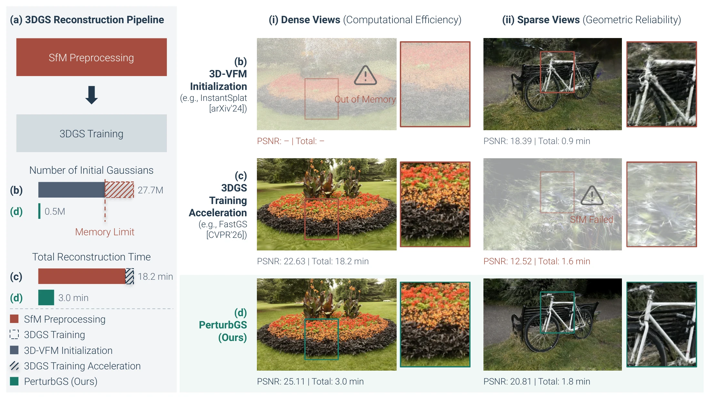
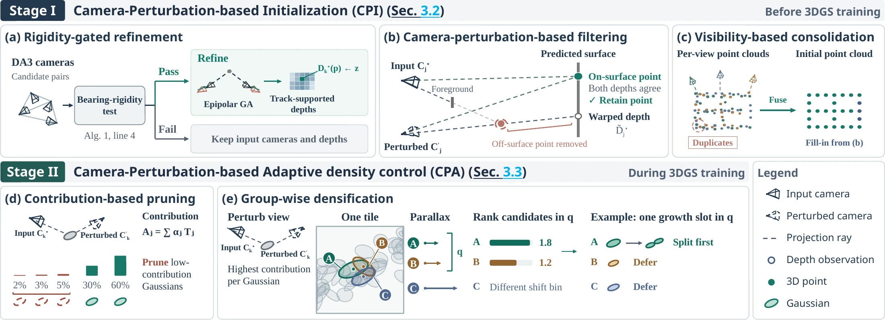

<h1>
  
  PerturbGS: Fast and Scalable Gaussian Splatting via Camera Perturbations
</h1>

**<a href="https://github.com/sh25youn2">Seokhyun Youn</a>**1,
**<a href="mailto:weeyoungkwon@cau.ac.kr">Weeyoung Kwon</a>**1,
**<a href="https://www.junhokim-xyz.com/">Junho Kim</a>**2,
**<a href="https://github.com/JihyongOh">Jihyong Oh</a>**1†
 

1Creative Vision and Multimedia Lab (CMLab), Chung-Ang University
2Cornell Tech
 
†Corresponding author

This repository is the official PyTorch implementation of
**"PerturbGS: Fast and Scalable Gaussian Splatting via Camera Perturbations."**

---

## News

- **2026.11.27**: PerturbGS [Project page](https://cmlab-korea.github.io/PerturbGS/) is initially released.

---

<b>Abstract</b>

 

Fast and scalable 3D Gaussian Splatting (3DGS) reconstruction from unposed input views requires both computational efficiency and geometric reliability.
With dense views, Structure-from-Motion (SfM) preprocessing dominates the total reconstruction time, and initializing Gaussians from the pixel-wise predictions of a 3D vision foundation model (3D-VFM) can exhaust GPU memory.
With sparse views, wide baselines can cause SfM registration to fail, and pose and depth errors in the predictions of the 3D-VFM can introduce artifacts in novel views.
We propose **PerturbGS**, a **view-count-agnostic** framework for fast and scalable 3DGS reconstruction from both dense and sparse views.
Our key insight is to use **camera perturbations** to expose **geometric ambiguity** before and during 3DGS training.
Before 3DGS training, our **Camera-Perturbation-based Initialization (CPI)** identifies depth-inconsistent point clouds through camera perturbations and removes them along with duplicate point clouds, yielding a compact initialization for 3DGS training.
During 3DGS training, our **Camera-Perturbation-based Adaptive density control (CPA)** prunes Gaussians with low rendering contribution across input and perturbed views.
Through camera perturbations, our CPA also groups Gaussians and densifies them group-wise, which limits the redundant growth of Gaussians.
Our PerturbGS reconstructs 3D scenes from dense views where previous methods exhaust GPU memory and produces sharper novel views with reduced artifacts from sparse views.

<b>Method Overview</b>

 

PerturbGS uses camera perturbations at two stages:

| Stage | Component | Description |
|-------|-----------|-------------|
| Before 3DGS training | **CPI**: Camera-Perturbation-based Initialization | Refines camera poses when the input views sufficiently constrain them, uses camera perturbations to filter depth-inconsistent points, and merges repeated observations to form a compact initial point cloud. |
| During 3DGS training | **CPA**: Camera-Perturbation-based Adaptive density control | Prunes Gaussians with low rendering contribution across input and perturbed views, and limits redundant allocation by assigning a shared densification budget to Gaussians with similar projected displacements. |

---

## Code Release

**Code will be released soon.** In the meantime, please visit our
[project page](https://cmlab-korea.github.io/PerturbGS/) for the video walkthrough, comparisons, and results.

---

## Results

Please visit our [project page](https://cmlab-korea.github.io/PerturbGS/) for:

- **Demo**: a video walkthrough of CPI and CPA using the figures of the paper.
- **Comparisons**: rendering clips on Mip-NeRF 360 and Deep Blending with 12, 24, 48, 96, and 192 input views, compared with the baselines at the same viewpoint.
- **Method** and **Parallax**: enlargeable method figures, and an interactive example of how points at different depths shift in the image under a camera perturbation.
- **Results**: PSNR, SSIM, LPIPS, and total reconstruction time for each dataset and number of input views.

---

## Acknowledgement

We sincerely thank the authors of
[3D Gaussian Splatting](https://github.com/graphdeco-inria/gaussian-splatting),
[Depth Anything 3](https://github.com/ByteDance-Seed/depth-anything-3),
[SAD-GS](https://github.com/LinjieLyu/SADGS),
[VGGT-X](https://github.com/Linketic/VGGT-X),
[InstantSplat](https://github.com/NVlabs/InstantSplat), and
[XFeat](https://github.com/verlab/accelerated_features)
for releasing their code, and the authors of
[FastGS](https://github.com/fastgs/FastGS),
[AirSplat](https://github.com/KAIST-VICLab/airsplat), and
[DropGaussian](https://github.com/DCVL-3D/DropGaussian_release)
for their public implementations.

---

## Citation

The BibTeX entry will be added with the arXiv release.

---

## Star History

